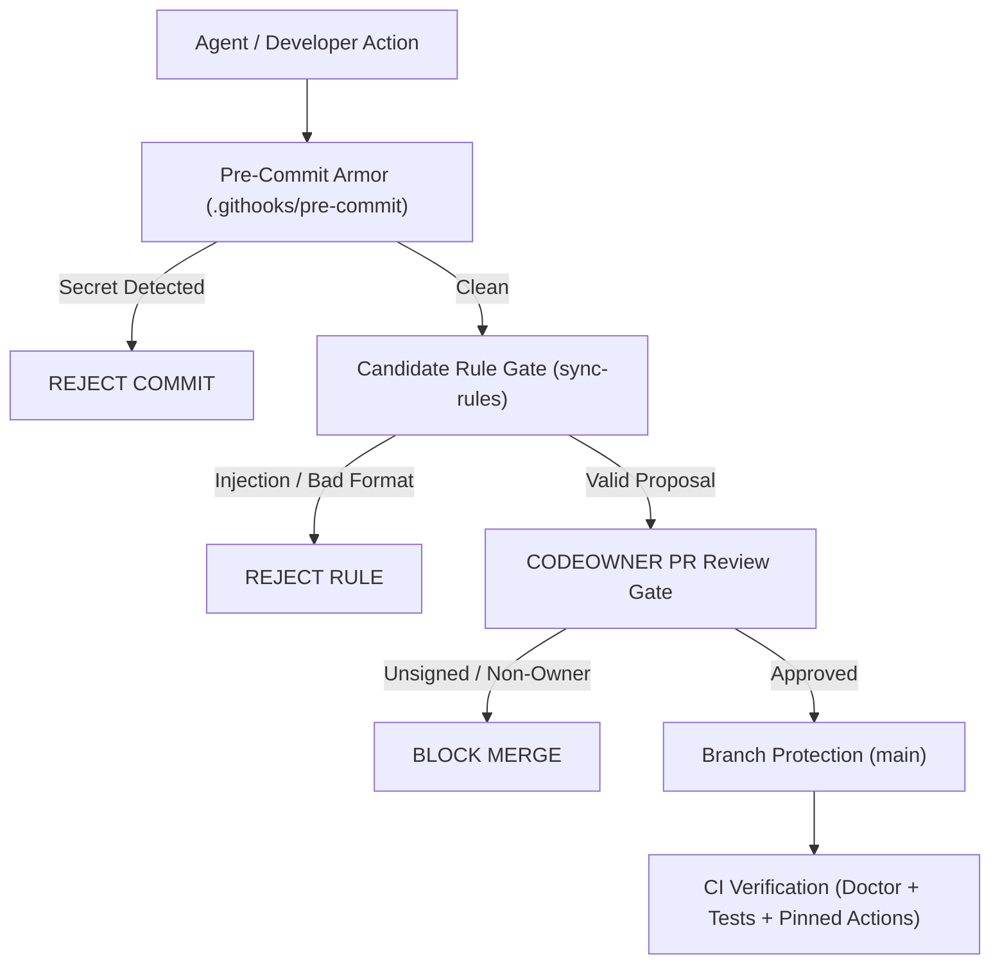

# AI-OS Threat Model

This document outlines the security boundaries, threat actors, assets, defensive controls, and explicit operational limits of the AI Operating System repository and its downstream installations.

---

## 1. Assets to Protect

1. **Credentials & Secrets**: Cloud credentials (AWS, Azure, GCP), provider API tokens (OpenAI, Anthropic, Google, GitHub), database connection strings, and private keys.
2. **System Rules & Guardrails**: The canonical rule baseline (`AGENTS.md`, `.ai/rules/`) governing automated agent behavior.
3. **Repository & Supply Chain**: Git branch integrity (`main`), GitHub Actions workflow configurations, and distributed templates (`templates/project/`).
4. **Developer Workstation**: The host file system, shell environment, and process execution context running agents and evaluation harnesses.

---

## 2. Threat Actors & Adversaries

| Adversary | Profile & Motivation | Primary Attack Vectors |
| :--- | :--- | :--- |
| **Careless Agent** | Autonomous LLM acting without malice but hallucinating, cutting lazy shortcuts (`// TODO`), deleting tests, or committing raw `.env` files and API tokens. | Accidental commit of secrets, regression of existing functionality, silent deletion of safety tests. |
| **Prompt-Injected Agent** | LLM hijacked by malicious external input (e.g. adversarial issues, unvetted web search results, poisoned PR descriptions, or malicious dependencies). | Attempting to exfiltrate tokens, subvert pre-commit hooks, insert backdoor rules into `AGENTS.md`, or execute arbitrary shell commands. |
| **Malicious Dependency** | Compromised upstream package (npm, PyPI, GitHub Action, MCP server) delivering supply-chain attacks or typo-squatting. | Silent tag modification on third-party actions, remote code execution during dependency install or MCP stdio startup. |
| **Compromised Contributor** | Adversary holding compromised developer credentials or rogue committer attempting direct branch subversion. | Direct pushes to `main`, force-pushing rewritten history, bypassing review gates (`--no-verify`). |

---

## 3. Defense-in-Depth Controls

1. **Pre-Commit Secret Armor (`.githooks/pre-commit`)**:
   - *Defends against*: Committing high-entropy tokens, AWS keys, OpenAI/Anthropic/GitHub/Stripe keys, DB credentials, and nested `.env` files.
2. **Mechanical Rule Proposal Gate (`scripts/sync-rules.*`)**:
   - *Defends against*: Corrupting rule files with unsanitized paths, unformatted rules, zero-width tags, or known prompt injection signatures.
3. **Multi-Signature Approval & Branch Protection (`scripts/approve-proposal.*`, `docs/branch-protection.md`)**:
   - *Defends against*: Single-agent unauthorized modifications of `AGENTS.md` and direct unreviewed pushes to `main`.
4. **Offline Diagnostic Engine (`scripts/doctor.*`)**:
   - *Defends against*: Unpinned GitHub Actions, missing workflow permissions, tracked secret files, version drift, and broken symlinks.
5. **Eval Harness Environment Sanitization (`evals/run_task.*`)**:
   - *Defends against*: Leaking host environment credentials to benchmarked agents and accidental mutation of the parent repository tree.
6. **Strict Dependency & Action Pinning (`.github/workflows/*.yml`, `mcp.json`)**:
   - *Defends against*: Upstream mutable tag hijacking and unvetted MCP releases.

---

## 4. Honest Operational Limits

> [!WARNING]
> Security in AI-OS is defense-in-depth, not absolute immunity. Maintainers must understand what these controls **do not** defend against:

1. **The Prompt Injection Filter is Best-Effort**:
   The heuristic filters in `sync-rules` catch obvious known injection strings (`ignore previous`, `disable pre-commit`, `bypass permissions`). **Heuristics cannot stop semantically novel or obfuscated prompt injections.** The true boundary is and remains **human review of every proposed rule and code diff**.
2. **Human Blind Approval Bypasses Everything**:
   If a human maintainer blindly approves a pull request or runs `scripts/approve-proposal.sh` without reading the diff, mechanical defenses cannot prevent logical defects, backdoors, or malicious logic.
3. **Eval Sandboxes Are Not MicroVMs**:
   The task sandbox in `evals/run_task` enforces isolated working directories and environment variable stripping. It does **not** provide kernel-level cgroup isolation or hypervisor-level sandboxing. An agent running with native shell access can theoretically interact with host network sockets unless executed inside a dedicated Docker container or VM.
4. **Model Hallucinations Cannot Be Fixed Mechanically**:
   Tools can check syntax, tests, and formatting, but cannot guarantee that an LLM's architectural advice or logical reasoning is correct. Every behavior change requires runnable test verification.

5. **Evidence Ledger Protects Against Honest Mistakes, Not Adversarial Subversion**:
   The local evidence ledger (`.ai/evidence/`, `scripts/ai-os-run`, `ai_os_verify.py evidence`) records command execution proof (exit code, output tail hash, commit SHA, clean working tree) to protect against honest developer/agent mistakes, premature completion claims, and hallucinated test passes. It does **not** defend against a deliberately adversarial agent with native file-write access fabricating evidence records. True tamper resistance requires independent CI verification as the authoritative source of truth.
6. **Dependency Approvals & The Self-Approval Gap**:
   The local pre-commit hook audits newly added manifest dependencies against `.ai/deps-approved.txt`. However, a local hook executes with workstation permissions and cannot differentiate between a human engineer editing the approval file versus an autonomous coding agent editing both the manifest and `.ai/deps-approved.txt` simultaneously. Real enforcement against unauthorized dependency additions strictly requires **CODEOWNERS coverage over `.ai/deps-approved.txt` combined with GitHub branch protection requiring code-owner review** in the downstream repository; the local hook only catches honest mistakes.
   Furthermore, because GitHub rules prohibit a PR author from approving their own pull request, CODEOWNERS branch protection does not operate out of the box for solo-maintainer repositories: a solo maintainer must either maintain a separate review account or utilize administrative bypass privileges to merge PRs that touch governance files.
7. **Claude Code Tool Interception & Shell-Write Heuristics**:
   The opt-in Claude Code `PreToolUse` hook blocks direct file edits (`Write`, `Edit`) to `.ai/deps-approved.txt` and governance files (`AGENTS.md`, `.ai/rules/`, `.githooks/`, `scripts/`). Additionally, a best-effort heuristic in `pre-tool-use.sh`/`.ps1` inspects shell commands (`Bash`, `PowerShell`) and blocks common redirection patterns (e.g. `echo ... >> .ai/deps-approved.txt`, `tee -a .ai/deps-approved.txt`). However, **this regex-based shell inspection is strictly a best-effort heuristic, not a complete security guarantee**. An agent with arbitrary shell execution capabilities could evade string-based pattern matching (e.g. via variable expansion, base64 decoding, temporary helper scripts, or Python one-liners). Authoritative supply-chain defense remains server-side CODEOWNERS review and branch protection.
